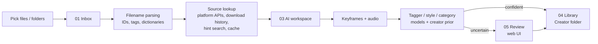

# vsort — Local AI Video Library Organizer

vsort is a Windows tool that sorts a large personal library of fan-made animation videos (MMD, 3D and 2D animation) into a clean, consistently named collection organized by creator. It reads messy filenames, finds the original source online, runs computer-vision and audio models **locally on the GPU**, and files each video automatically. When the system isn't sure, it sends the video to a human review queue instead of guessing.

Every file operation can be undone. Nothing moves until you approve the dry-run plan.

> Full command reference: [docs/USAGE.md](docs/USAGE.md)

## Highlights

- **End-to-end pipeline**: ingest → filename parsing → source lookup → AI analysis → auto-file or human review, started from one click in a local web UI.
- **Calibrated automation**: on a 251-video validation set, about **87% of videos are filed automatically at about 90% accuracy**. The rest go to review, each with a stated reason and preview frames.
- **Creator re-identification**: SigLIP "style fingerprints" match videos from unknown creators against known ones. With a similarity ≥ 0.5 and a lead of ≥ 0.1 over the runner-up, guesses were **98% correct on 421 videos**.
- **Safety-first file handling**: dry-run by default, an append-only operation journal, undo of single runs or whole batches, crash-resume, never overwriting a file, and copy-verify-delete moves across drives.
- **Private by design**: all models run locally and videos are never uploaded. Credentials live in a git-ignored file.
- **About 7.9k lines of Python** and **153 pytest tests**.

## How it works



### 1. Ingest and parse
- Only processes files the user explicitly picks, either through native Windows file dialogs or the web UI.
- Classifies the filename pattern; extracts platform post IDs, titles, dates and bracketed tags; and normalizes Unicode.
- Matches works and characters against editable CSV dictionaries with aliases in several languages.
- Identifies creators by **platform account ID** rather than display name, so renamed accounts still resolve to the same person. New or ambiguous aliases go to a pending list for user confirmation.

### 2. Source lookup
- Queries creator platforms (e.g. Patreon, pixiv FANBOX, Fantia) for title, author and tags, falling back through public data, archive mirrors and optional cookies.
- If the filename has no ID, it recovers the original URL from the **download manager's history** (matched by file size and name) or searches using filename hints (creator folder, title, date).
- Uses a small standard-library HTTP layer with per-site rate limits, timeouts, error classification and an on-disk cache. Network failures are retried on the next run.

### 3. Local AI analysis
| Signal | Model / method |
|---|---|
| Keyframes | `ffmpeg`, sampled evenly through the video |
| Characters and visual tags | WD-style anime tagger (PixAI tagger by default; swappable for WD EVA02 or Camie, with a comparison script) |
| Animation style (multi-label: MMD / 3D / 2D …) | CLIP and SigLIP 2 zero-shot vs. a small classifier trained on user labels. A benchmark picks the best. |
| Content category (Dance / Mix / Scene) | Trained classifier fusing tag statistics, **Qwen3-VL** per-frame and video-level judgments, and **audio features** (tempo, vocal presence, timbre via `librosa`) |
| Creator prior | Category probabilities reweighted by the creator's historical distribution, tuned on validation data |

- A video is filed automatically only when the top category probability clears a tuned threshold (0.7). Disagreements between filename and model, low style confidence, or a missing creator or character send it to review.
- Category criteria live in local data files, not in code: the vision-language prompts (`prompts/`) and the tagger label list (`dict/scene_tags.txt`). Changing the definition means editing text files and retraining, not changing code.
- Results are cached, so applying a reviewed dry run doesn't recompute anything.

### 4. Human-in-the-loop review
- A localhost-only web app shows preview frames, the reason each video was flagged, and editable fields. Confirming a video files it.
- A CSV round-trip through Excel is also supported.
- A labeling UI collects training samples, with uncertainty sampling to pick the most informative videos to label next.
- Batch history shows where every video from each import ended up and can roll back a whole batch.

### 5. Output
```
Library\<Creator>\<Title> [Creator][Work][Characters][Style][Category].mp4
Library\<Creator>\<Title> ... .vsort.json   ← sidecar: original path, batch ID, parse + AI results
```

## Engineering details

- **Operation journal** (`journal.py`): every plan is written before it runs. Undo replays the journal in reverse, and interrupted runs resume where they stopped.
- **Cross-drive moves** (`fileops.py`): copy to a temp file, verify size and content, rename, then delete the source.
- **Duplicate detection** (`dupes.py`): file size plus hashes of the head, middle and tail of each file.
- **Configurable**: models, thresholds, folders and lookup sources are all in `config.yaml`.

## Tech stack

Python 3.12 · PyTorch · Hugging Face Transformers · scikit-learn · NumPy · librosa · Pillow · ffmpeg · stdlib `http.server` web UI · tkinter dialogs · pytest

## Project layout

```
vsort/        core package (CLI, pipeline, parser, lookup, AI models, web UI)
tests/        pytest suite
tools/        model comparison and evaluation scripts
dict/         editable CSV dictionaries (works, characters, creators) and tag lists
prompts/      vision-language model prompts (*.example.txt; local *.txt overrides are git-ignored)
config.yaml   all settings
```

## Getting started

```bat
python -m venv .venv --system-site-packages   :: reuse an existing CUDA PyTorch install
.venv\Scripts\pip install pyyaml transformers huggingface_hub scikit-learn librosa pillow
vsort.bat init        :: create the workspace folders
vsort.bat web         :: open the local web UI
```

The common commands are dry runs; add `--apply` to execute. `vsort.bat undo` reverses the last run. See the [usage guide](docs/USAGE.md) for every command.

```bat
.venv\Scripts\python.exe -m pytest -q
```
